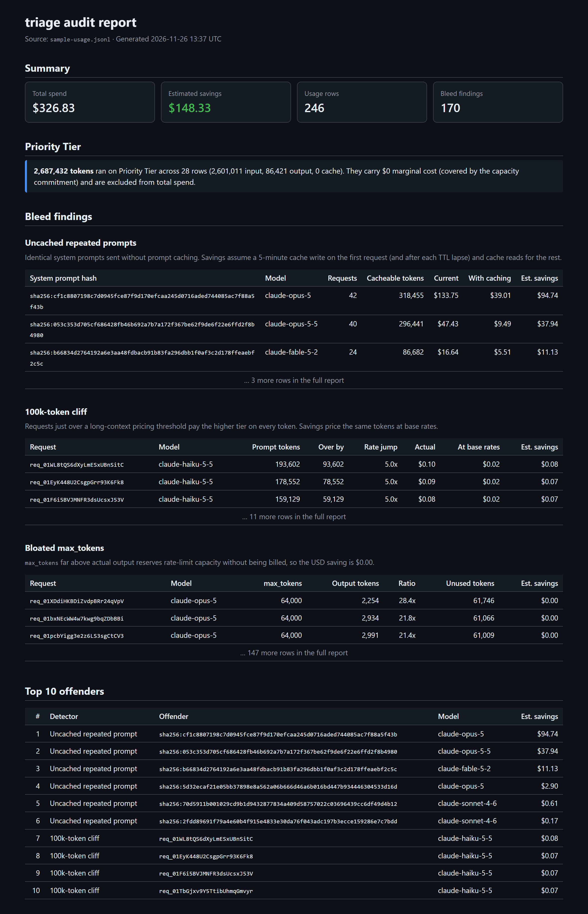
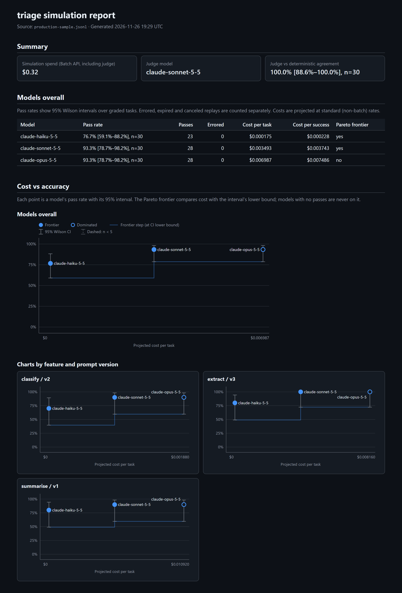

<h1>
  <picture>
    <source media="(prefers-color-scheme: dark)" srcset="docs/logo-dark.svg">
    
  </picture>
</h1>

Find where your Claude API spend is leaking, then test whether a cheaper model can do the job,
using the logs you already have.

- **`triage audit`** reads usage logs, Anthropic Console exports or Claude Code session logs
  and flags waste such as:
  - repeated prompts sent uncached
  - requests over a long-context price cliff
  - oversized `max_tokens`
  - spend concentration
  It runs offline, makes no API calls and needs no prompt text.

- **`triage simulate`** replays logged single-turn requests against other Claude models through
  the Message Batches API, grades the answers, and compares cost with pass rate. Pass rates
  always come with a 95% confidence interval (Wilson score) and sample size, and can gate a CI job.

There is no proxy, SDK wrapper or hosted service: no third-party server ever touches your data.



*Excerpt of the HTML report for synthetic data: long findings tables are shortened and the
spend concentration section is omitted.*

Try it from a clone (offline, no API key):

```bash
uv run triage audit examples/sample-usage.jsonl -o reports/
```

## Installation

Requires Python 3.12+ and [uv](https://docs.astral.sh/uv/).

Install the `triage` command from GitHub:

```bash
uv tool install git+https://github.com/tharunkrsh/triage.git
triage --help
```

Use the Git URL: the `triage` package on PyPI is an unrelated project.

Or run it from a clone, which is also how to try the examples below:

```bash
git clone https://github.com/tharunkrsh/triage.git
cd triage
uv run triage --help
```

## Quickstart

The commands below use small synthetic files from `tests/fixtures/`. From an installed tool,
drop the `uv run` prefix and point at your own files.

### Audit spend (offline, free)

```bash
uv run triage audit tests/fixtures/ingest/sample.jsonl -o reports/
```

```text
          Audit: sample.jsonl
┌─────────────────────────────┬───────┐
│ Total spend                 │ $0.08 │
│ Estimated savings           │ $0.05 │
│ Priority Tier tokens ($0)   │     0 │
│ Uncached repeated prompts   │     0 │
│ 100k-token cliff requests   │     1 │
│ Bloated max_tokens requests │     2 │
└─────────────────────────────┴───────┘
Wrote reports/triage-audit.md
Wrote reports/triage-audit.html
```

The reports break spend down by model, feature, API key and workspace, and list the largest
savings opportunities. Estimated savings cover uncached repeats and cliff crossings;
`max_tokens` findings are reported without a dollar figure.

`triage ingest <file>` previews how a file will be parsed. `--format` overrides auto-detection
(`console-csv`, `console-json`, `jsonl`, `claude-code`) and `--strict` fails on the first
invalid row.

### Audit Claude Code usage

Claude Code keeps a JSONL log of every session under `~/.claude/projects/`. Point `audit` at
that folder to see what your own Claude Code sessions cost. 

```bash
uv run triage audit "~/.claude/projects" -o reports/
```

- Each session is tagged with a project taken from the folder it ran in (Claude Code
  worktrees count as their repository). Sessions started in your home directory are tagged
  `(home)`, so your user name never shows up in a report.
- Subagent sessions are included, and a response logged on several lines is counted once.
- Totals are a **lower bound**: Claude Code deletes old session logs, so only sessions still on
  disk are counted, and responses from models missing from `pricing.yaml` are skipped with a
  warning.
- Only token usage is read; prompt and response text never goes into a record.

Useful for tracking API/Bedrock spend by project, catching subagent or Opus quota burn, and checking whether a Pro/Max subscription beats pay-as-you-go.

### Folders and globs

`ingest`, `audit` and `simulate` all take a single file, a folder (searched recursively for
`.jsonl` and `.ndjson` files) or a glob pattern, including `**`:

```bash
uv run triage audit logs/                         # every JSONL file under logs/
uv run triage audit "logs/2026-11-*.jsonl"        # quote globs so the shell leaves them alone
uv run triage simulate "replays/**/*.jsonl" -t haiku-5-5 --dry-run
```

### Estimate a simulation (`--dry-run`, free)

```bash
uv run triage simulate tests/fixtures/simulate/replay.jsonl -t claude-haiku-5-5 -t claude-sonnet-5-5 --dry-run
```

```text
                       Estimated Batch API spend
┌─────────────────────┬───────────┬──────────┬──────────┬─────────────┐
│ Model               │ Role      │ Requests │ Expected │ Upper bound │
├─────────────────────┼───────────┼──────────┼──────────┼─────────────┤
│ claude-haiku-5-5    │ candidate │        4 │    $0.04 │       $0.05 │
│ claude-sonnet-5-5   │ candidate │        4 │    $0.16 │       $0.22 │
│ claude-sonnet-5-5 * │ judge     │        8 │    $0.33 │       $0.50 │
│ Total               │           │       16 │    $0.52 │       $0.76 │
└─────────────────────┴───────────┴──────────┴──────────┴─────────────┘
                  * token counts partly approximated
Dry run: nothing was submitted.
```

A dry run needs no API key. The fixture deliberately includes invalid rows, so you will also
see warnings for the lines that were skipped. The upper bound assumes every response runs to
`max_tokens`; input token counts are still estimates.

<details>
<summary>Sample simulation report</summary>



*Excerpt of the HTML report for a 30-task synthetic replay set. The model outputs and judge
verdicts are synthetic too, served by a local stand-in for the Batch API, so they are not real
model results.*

</details>

### Run it (paid)

```bash
export ANTHROPIC_API_KEY=...        # PowerShell: $env:ANTHROPIC_API_KEY = "..."
uv run triage simulate replay.jsonl -t haiku-5-5 -t sonnet-5-5 -o reports/
```

`triage` prints the estimate and, in an interactive terminal, asks before submitting.
**Without a terminal (CI, pipes) it proceeds without asking**, so run `--dry-run` first.

| Option | Effect |
| --- | --- |
| `--target`, `-t` | Candidate model; repeat to compare several |
| `--judge-model` | Model that grades responses (default `claude-sonnet-5-5`) |
| `--no-judge` | Deterministic checks only |
| `--sample N`, `--seed S` | Replay a reproducible random subset |
| `--yes`, `-y` | Skip the spend confirmation |
| `--min-pass-rate P` | Exit 1 if any target's 95% lower bound is below `P` (0 to 1) |
| `--output-dir`, `-o` | Where to write `triage-simulate.md` and `.html` |

### Gate CI on quality (`--min-pass-rate`)

```bash
uv run triage simulate replay.jsonl -t haiku-5-5 --min-pass-rate 0.8 --yes -o reports/
```

Illustrative output for two targets, generated from the replay fixture with a stubbed API
client (not real model results):

```text
                             Simulation results
┌───────────────────┬────────────────────────────┬─────────┬───────────────┐
│ Model             │ Pass rate [95% CI]         │ Errored │ Cost per task │
├───────────────────┼────────────────────────────┼─────────┼───────────────┤
│ claude-haiku-5-5  │ 100.0% [43.8%–100.0%], n=3 │       1 │     $0.000020 │
│ claude-sonnet-5-5 │ 100.0% [51.0%–100.0%], n=4 │       0 │     $0.000400 │
└───────────────────┴────────────────────────────┴─────────┴───────────────┘
below --min-pass-rate: claude-haiku-5-5 lower bound 0.438 < 0.8
below --min-pass-rate: claude-sonnet-5-5 lower bound 0.510 < 0.8
```

The gate compares the **lower bound**, not the observed rate, so a perfect score on a handful
of tasks still fails. With every task passing, clearing 0.8 takes at least 16 graded tasks, and
clearing 0.95 takes at least 73. Reports are written before the command exits non-zero. A dry
run never applies the gate. Errored requests are counted separately and excluded from the pass
rate, so check that column too.

## Input format

`audit` accepts Anthropic Console usage exports (CSV or JSON) or JSONL with one request per
line. Token counts can be top-level fields or an API-style `usage` object:

```json
{"request_id": "req_001", "timestamp": "2026-10-01T09:00:00Z", "model": "claude-sonnet-5-5", "input_tokens": 2400, "output_tokens": 180, "max_tokens": 4096, "feature": "summarise", "system_prompt_hash": "sha256:aaa"}
```

`simulate` needs JSONL that also carries the request and the response you got in production:

```json
{"task_id": "t-1", "feature": "extract", "prompt_version": "v2", "baseline_model": "claude-sonnet-4-6", "messages": [{"role": "user", "content": "Extract name and age as JSON: Ada Lovelace, 36."}], "baseline_response": "{\"name\": \"Ada Lovelace\", \"age\": 36}", "expected_schema": {"type": "object", "required": ["name", "age"]}, "usage": {"input_tokens": 900, "output_tokens": 20}}
```

`system`, `tools`, `tool_choice` and `max_tokens` are optional. Multi-turn conversations are
skipped with a warning.

## How grading works

1. **Deterministic checks**, where they apply: tool calls must match the baseline's names and
   arguments; otherwise output must satisfy `expected_schema`, or at least parse as JSON when
   the baseline did. Tools are never executed.
2. **LLM judge** (unless `--no-judge`): grades each successful response against the baseline for
   semantic parity.

A task passes only if every grader that ran passed it. Tasks that nothing graded are excluded
from the pass rate. Reports also show how often the deterministic checks and the judge agree.

## Architecture

```text
 usage logs / Console export                replay JSONL
             │                                   │
             ▼                                   ▼
      ingest/ adapters ─────────────► pydantic v2 records ◄──── pricing.yaml
             │                                   │                (pricing.py)
             ▼                                   ▼
   audit/  DuckDB SQL            simulate/  estimate ─► confirm ─► Batch API
   bleed detectors                          deterministic checks + LLM judge
             │                              DuckDB aggregates, Wilson CIs,
             │                              Pareto frontier
             └──────────────► report/ (Jinja2) ◄───────┘
                          Markdown + self-contained HTML
```

| Module | Responsibility |
| --- | --- |
| `cli.py` | Typer commands: `ingest`, `audit`, `simulate` |
| `ingest/` | Console CSV/JSON, JSONL and Claude Code adapters; file, folder and glob inputs |
| `pricing.py` | Loads `pricing.yaml` and computes per-request cost |
| `audit/` | Bleed detection in DuckDB SQL |
| `simulate/` | Cost estimate, batch submission, graders, statistics, summaries |
| `report/` | Report rendering and templates |

Design choices:

- **Pricing is data.** Rates, price cliffs, cache multipliers, batch discounts and audit
  thresholds live in [`pricing.yaml`](pricing.yaml), which records its source and retrieval
  date. Check it against current pricing before relying on the figures. Set `TRIAGE_PRICING`
  to use your own file.
- **Exact per-request pricing.** `pricing.py` computes costs as `Decimal`.
- **Spend is visible first.** Every simulation prints an estimate before submitting anything.
- **Data stays local for audits.** `simulate` sends the replayed requests, and the judge's
  comparison of both responses, to the Anthropic API.

Out of scope for v1: live proxying, multi-turn or agentic replay, third-party observability
adapters and a hosted UI. See [`SPEC.md`](SPEC.md) and [`ARCHITECTURE.md`](ARCHITECTURE.md).

## Development

```bash
uv sync
uv run pytest
uv run ruff check . && uv run ruff format --check .
```

Tests run offline with a fake Anthropic client and need no API key.
